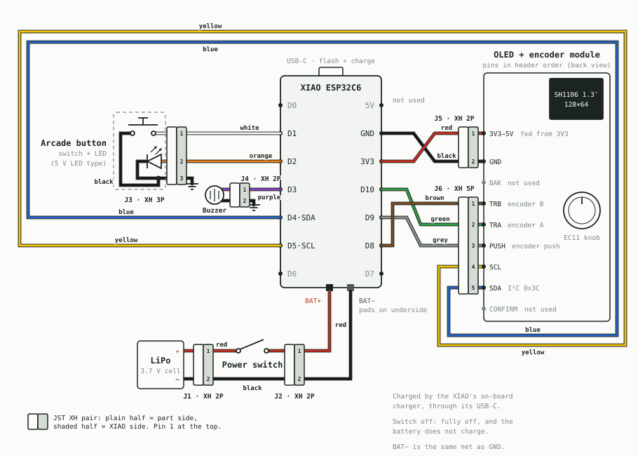

# Tiger Timer — Functional Specification Document

**Document purpose:** This FSD is written to be self-contained. It describes *what* the device
does and *why*, in enough detail that a competent firmware engineer (or an AI coding model)
could implement it from this document alone, without needing the existing source code as a
starting point. Where exact pixel-level visual fidelity isn't practical to fully specify in
prose, that's called out explicitly (see "Known Limits of This Document" at the end) — for
pixel-perfect reproduction, the actual source files are the ground truth and should be used
alongside this FSD, not instead of it.

Product name: **Tiger Timer**. On-device boot splash reads "TIGER" then "TIMER" as two words
merging together (see §4.1).

---

## 1. Overview

Tiger Timer is a battery-powered, pocket-sized party-game console built on an ESP32
microcontroller with a small monochrome OLED screen, one rotary encoder, one large arcade-style
push button, and a piezo buzzer. It boots into a scrollable menu of **13 mini-games** plus a
Settings and an Instructions entry. Each game is self-contained, uses the same two physical
controls (encoder + button) with a consistent global interaction model, and returns to the menu
via a confirmation dialog so gameplay is never lost by accident.

A secondary feature, **Remote Config**, turns the device into its own WiFi access point serving a
web page (from any phone or laptop) for editing settings that aren't practical to edit with a
single knob and one button: reordering/enabling games, editing trivia questions in bulk,
enabling/disabling "Pass the Bomb" categories, resetting per-game high scores, and choosing
startup behavior.

The interface is fully localized into English, French, and Spanish, chosen via a Settings screen
and persisted across power cycles.

---

## 2. Hardware Specification

### 2.1 Microcontroller
- **Board:** Seeed Studio XIAO ESP32C6 (or pin-compatible equivalent). Uses the Arduino core's
  `D0`–`D10` pin aliases throughout this spec and the firmware.
- **Framework:** Arduino core for ESP32 (not raw ESP-IDF).

### 2.2 Display
- **Panel:** SH1106-driver monochrome OLED, 1.3″, 128×64 pixels, I2C interface, address `0x3C`.
- **Module:** the screen and the rotary encoder (§2.4) share one ready-made board, a 1.3″ OLED +
  EC11 encoder module that also carries two tactile buttons, BACK and CONFIRM. It has a single
  9-pin header. Seen from the back (solder side), left to right it reads `3V3–5V GND BAK
  ENCODER_TRB ENCODER_TRA ENCODER_PUSH OLED_SCL OLED_SDA CONFIRM` (short names below: `VCC`,
  `GND`, `BAK`, `TRB`, `TRA`, `PUSH`, `SCL`, `SDA`, `CON`).
- **Wiring:** SDA → `D4`, SCL → `D5`, VCC → 3.3V, GND → GND (shared with the encoder). The
  module accepts 3.3–5 V on VCC, but it is fed from the XIAO's 3V3 so its I2C lines stay at the
  XIAO's 3.3 V logic level.
- **Library:** Adafruit SH110X (pulls in Adafruit GFX Library + Adafruit BusIO via Library
  Manager).
- Orientation: normally landscape (128 wide × 64 tall). Two specific games (Tetris and Star
  Drop — see §5.9, §5.10) temporarily rotate the display 90° in software only while their own
  screens are drawn, then rotate back to normal before returning control — no other screen is
  ever affected by this. All other games, including Snake, Pong and SimpleMorse, deliberately stay in
  normal orientation.

### 2.3 Input: Arcade Button
- A large illuminated arcade-style push button.
- Switch: `D1` → GND, wired `INPUT_PULLUP` (electrically LOW = pressed).
- Built-in LED: 5V, driven directly from a GPIO with no boost circuitry needed → `D2` (+GND).
  The LED is used as a persistent state indicator across nearly every game (see per-game specs).
- Debounced in software (~a few ms) before any action fires.
- The exact instant of each press is timestamped (`buttonPressStart`), not just used for
  debouncing — this is reused by both the Reflex game (reaction time) and SimpleMorse
  (short-vs-long press classification, see §5.12).

### 2.4 Input: Rotary Encoder
- An EC11-style incremental rotary encoder with integrated push-button, on the same module
  as the display (§2.2). On the module header, encoder A is `TRA`, B is `TRB` and the push
  button is `PUSH`.
- CLK (`TRA`) → `D10`, DT (`TRB`) → `D8`, SW (`PUSH`) → `D9`, wired `INPUT_PULLUP` (LOW =
  pressed). If turning clockwise moves the wrong way, swap the `TRA` and `TRB` wires.
- The module's BACK (`BAK`) and CONFIRM (`CON`) buttons are not connected and not used by the
  firmware.
- Rotation is decoded in a pin-change interrupt on **both** `CLK` and `DT` (full quadrature,
  Gray-code transition table), so detents aren't lost while the main loop is busy with a screen
  transfer (~25 ms) or a blocking sound. One detent = one full cycle of the two contacts, counted
  when they return to rest (both HIGH) after moving at least half a cycle one way: contact bounce
  alternates +1/−1 and nets to zero instead of reading as a turn backwards, and an impossible
  jump (both contacts changing at once) counts nothing. Clockwise (`CLK` falls while `DT` is HIGH)
  = `direction = +1`, counter-clockwise = `−1`.
- The main loop takes every detent counted since its last pass in one batch and applies them one
  at a time to the current screen, redrawing once at the end. Pong applies the whole batch to the
  paddle in one move (see §5.13). A batch of detents that wakes a sleeping screen is discarded.
- The encoder's own push button is debounced independently from the arcade button and supports
  three distinct gestures: **short click**, **long-press (1 second)**, and **hold+turn**. See
  §3.2.

### 2.5 Audio
- A passive piezo buzzer (not an active/self-oscillating buzzer — it must be frequency-driven).
- Wired to `D3` (+ GND).
- Driven via the ESP32's LEDC PWM peripheral: `ledcAttach(pin, 2000, bits)` once at boot, then
  `ledcWriteTone(pin, frequency)` to set a tone's pitch and `ledcWrite(pin, duty)` to set its
  loudness (volume-dependent duty cycle, see below).
- Two calling conventions exist:
  - **`playNote(freq, durationMs)`** — blocking: sets the tone, delays for the given duration,
    then silences. Used for short fixed-length beeps and jingles throughout the app.
  - **`startTone(freq)` / `stopTone()`** — non-blocking: starts or stops a tone immediately,
    with no built-in duration. Needed anywhere a tone must persist across many main-loop
    iterations instead of a single fixed duration — currently only SimpleMorse's live
    press-and-hold feedback (§5.12). `stopTone()` is safe to call even when nothing is playing,
    and should be called unconditionally on every button release rather than gated behind a
    state check — a real bug shipped once where a state check that matched at press-time no
    longer matched by release-time (because legitimate game logic changed the state in between),
    silently skipping the stop and leaving a tone stuck on.
- Volume is implemented as **PWM duty cycle**, not amplitude in software mixing — three levels:
  - Mute: duty 0 (buzzer calls are skipped entirely, not silently played at 0 duty, to avoid
    wasting the delay time a note would otherwise block for).
  - Low: duty 40/255.
  - High: duty 128/255 (chosen to roughly match the loudness of the classic Arduino `tone()`
    function, for continuity with an earlier prototype).

### 2.6 Power
- **Battery:** 3.7V LiPo cell.
- **Battery wiring:** the cell goes to the XIAO's `BAT +` / `BAT −` pads on the underside of the
  board, through two JST XH 2-pin connectors (J1 at the cell, J2 between the switch and the
  XIAO, §2.7). There is no separate charger module.
- **Charging:** by the XIAO's own on-board charger, through its USB-C port (the same port used
  for flashing). That charge chip is separate from the ESP32 itself, so charging continues while
  the ESP32 is in deep sleep.
- **Physical power switch:** yes — a hard power switch between the battery's + lead and the
  `BAT +` pad, in addition to software deep sleep. (Deep sleep is the *software-controlled*
  low-power state used automatically after inactivity; the physical switch is a full hardware
  disconnect for storage/shipping.) Because the switch also cuts the battery off from the
  charger, **the battery only charges while the switch is on**. Leaving it on to charge is fine:
  the box drops into deep sleep after 30 idle minutes.
- **Deep sleep wake source:** `esp_sleep_enable_ext1_wakeup` on the arcade button pin
  (`ESP_EXT1_WAKEUP_ANY_LOW`). Waking from deep sleep is a full reboot (runs `setup()` again),
  not a resume-from-RAM.
- **Wake pin pull-up, learned the hard way:** for sleep the pin is handed to the chip's
  low-power (RTC/LP) IO block, which has its **own** pull-up — the `INPUT_PULLUP` from `setup()`
  is the normal digital one and does not carry over. So before sleeping the firmware explicitly
  enables the LP pull-up on the pin (`rtc_gpio_init` / `rtc_gpio_pullup_en`, pull-down off) and
  keeps the RTC peripheral power domain on so it stays powered. Without this the pin floated
  LOW and the board woke — rebooting, startup chime included — the instant it went to sleep
  after 30 idle minutes. On boot `setup()` hands the pin back to the normal GPIO
  (`rtc_gpio_hold_dis` + `rtc_gpio_deinit`) before `pinMode`.
- **Bench-testing sleep:** two build-time flags exist only for testing, never set in a normal
  build: `TT_DEEP_SLEEP_TIMEOUT_MS` overrides the 30-minute timeout (e.g. 20000), and
  `TT_SLEEP_TEST_TIMER_WAKE_S` adds a timer wake so a test can watch the board stay asleep and
  come back by itself. Pass them via
  `--build-property "compiler.cpp.extra_flags=-DTT_DEEP_SLEEP_TIMEOUT_MS=20000UL -DTT_SLEEP_TEST_TIMER_WAKE_S=40"`.

### 2.7 Wiring Diagram

`assets/wiring_diagram.svg` is the schematic of everything in §2.1–§2.6. Every part connects
to the XIAO through a JST XH connector (J1–J6, below), so each part can be unplugged without
desoldering. No external resistors are needed: the arcade switch, the encoder and the wake pin
all use the chip's internal pull-ups. The drawing also shows the OLED + encoder module's header
in its printed order, with the wire colour for each pin.

| Part | Part pin | XIAO | Wire | Notes |
|---|---|---|---|---|
| Arcade button | Switch | `D1` | white | `INPUT_PULLUP`, LOW = pressed. Also the deep-sleep wake pin (§2.6). |
| | LED + | `D2` | orange | Driven directly by the GPIO. |
| | Switch GND leg | GND | black | Its own lead from the button. |
| | LED − | GND | black | Its own lead from the button. Both ground leads go into J3 pin 3 (double-crimp, or splice to one short lead). |
| Piezo buzzer | + | `D3` | purple | − to GND. Must be passive (§2.5). |
| OLED + encoder module | SDA / SCL | `D4` / `D5` | blue / yellow | I2C address `0x3C`. |
| | TRA / TRB | `D10` / `D8` | green / brown | Encoder A / B (CLK / DT in the firmware). Swap them if turning feels reversed. |
| | PUSH | `D9` | grey | Encoder push. `INPUT_PULLUP`, LOW = pressed. |
| | VCC / GND | 3V3 / GND | red / black | Header pin printed `3V3–5V`. Feed it from 3V3, not the 5V pin: 5V only carries USB power, and 3V3 keeps the I2C lines at 3.3 V. |
| | BAK / CON | — | — | BACK and CONFIRM buttons, not connected (free pins `D0`/`D6`/`D7` could take them later). |
| LiPo 3.7 V | + | `BAT +` pad | red | Through the physical power switch. Pad on the underside, marked "+". |
| | − | `BAT −` pad | black | Pad on the underside, marked "−". Same net as GND. |

**Connectors.** All are JST XH (2.5 mm pitch). In the drawing each one is a mating pair: the plain
half is on the part's side, the shaded half on the XIAO's side, and pin 1 is at the top.

| J | Between | Pins | Pin 1 | Pin 2 | Pin 3 | Pin 4 | Pin 5 |
|---|---|---|---|---|---|---|---|
| J1 | LiPo ↔ power switch | 2 | + (red) | − (black) | | | |
| J2 | Power switch ↔ XIAO `BAT` pads | 2 | + switched (red) | − (black) | | | |
| J3 | Arcade button ↔ XIAO | 3 | switch `D1` (white) | LED `D2` (orange) | GND (black, switch + LED leads) | | |
| J4 | Buzzer ↔ XIAO | 2 | + `D3` (purple) | − GND (black) | | | |
| J5 | Module power ↔ XIAO | 2 | VCC 3V3 (red) | GND (black) | | | |
| J6 | Module signals ↔ XIAO | 5 | TRB `D8` (brown) | TRA `D10` (green) | PUSH `D9` (grey) | SCL `D5` (yellow) | SDA `D4` (blue) |

J5 and J6 follow the module's header order (pin 1 nearest the `3V3–5V` end), so their
module-side leads run straight off the header; the wires cross over between the connectors and
the XIAO instead, as drawn.
The battery's − lead passes through both J1 and J2 without going through the switch, which is
only in the + lead. J2 lets the switch stay mounted in the case while the XIAO comes out.
The different pin counts stop most mix-ups, but J1, J2, J4 and J5 are all 2-pin. Label them, or
keep each lead too short to reach the wrong socket: a battery lead plugged into a 2-pin socket
meant for something else can short the cell or reverse its polarity.

- **Arcade LED brightness:** arcade LEDs rated 5 V have a resistor built in, so `D2` drives them
  directly; at 3.3 V they glow a little dimmer. A bare LED without its own resistor needs about
  100 Ω in series.
- **Cable colours:** red for every positive supply (battery + and 3V3), black for every
  ground, and one colour per signal as listed above (SDA blue / SCL yellow follows the usual
  I2C convention). The arcade button's two ground leads and the buzzer's − lead are black too.
- **Free pins:** `D0`, `D6` and `D7` are unused.
- **Power:** the battery goes to the `BAT` pads through J1 and J2, with the power switch in the + lead.
  Check polarity before soldering: reversing + and − on these pads can destroy the board. Use a
  LiPo with its own protection circuit, since the XIAO does not cut off a deeply discharged cell.

---

## 3. Global System Behavior

### 3.1 Boot Sequence
1. Power on (or wake from deep sleep) → `setup()` runs.
2. Load all persisted settings from flash (see §3.5 for the full key list).
3. Mount the filesystem used for trivia question data (LittleFS); format it automatically on
   first-ever boot if unformatted.
4. Initialize the display, encoder pins, button pin, buzzer PWM channel. Then print a one-line
   boot summary on USB serial (115200 baud), e.g.
   `[boot] Tiger Timer - reset=11 wake=0, OLED ok, LittleFS ok (272/1408 KB used), config.html present, sports_junior.csv present, lang=1`
   — so a connected computer can confirm a healthy boot, and that the data files are present,
   without looking at the screen. `reset` is `esp_reset_reason()` (1 power-on, 3 software,
   4 crash, 8 deep-sleep wake, 9 brown-out, 11 USB) and `wake` is
   `esp_sleep_get_wakeup_cause()` (0 not a sleep wake, 3 ext1 = button, 4 timer), which shows
   at a glance whether an unexpected reboot was a sleep wake, a crash or a power dip.
5. Play the boot splash animation (§4.1) — **unless the arcade button is held down**, in which
   case the splash is skipped entirely and the device proceeds straight to step 6. (See §3.6 for
   why this is button-debounce-safe.)
6. Apply the configured startup behavior: either open directly on the main menu, or boot
   straight into a specific chosen game (both configurable via Remote Config, §7).

### 3.2 Global Input Model

This is the single most important section for consistent behavior across every screen. There
are exactly two physical controls, and their meaning is the same everywhere except where a
game explicitly overrides it:

| Control | Gesture | Meaning |
|---|---|---|
| Arcade button | Short press | **Confirm / primary action.** In a menu-type screen (main menu, Settings, Language picker, Timer Step picker, Instructions, the leave-confirmation dialog) this confirms whichever item is highlighted. Inside a game, this is that game's main action (start countdown, roll dice, arm the bomb, etc. — see each game's spec). |
| Encoder | Turn (not held) | Moves a selection cursor, adjusts a numeric value, or performs a game-specific action, depending on the current screen (see each game's spec). |
| Encoder | Short click (press+release, not held past ~1s, no turn while held) | **Also confirm / primary action** — functionally identical to the arcade button's short press in every menu-type screen. Inside some games it does a secondary context action instead (see the per-game "Encoder click" rows below) if that game defines one; otherwise it does nothing. |
| Encoder | Held down and turned | **Adjusts buzzer volume**, from *anywhere*, at *any time*, even mid-game. While held+turning, the screen switches to a full-screen volume indicator (§6.2) live-updating with every detent; releasing restores whatever screen was showing underneath. This gesture "claims" the hold, so releasing afterward does **not** also fire a click action. |
| Encoder | Held for 1 full second *without* being turned | **Opens the "Go back to menu?" dialog** if currently inside a game (§3.4). **From the Settings list specifically, jumps straight back to the main menu with no confirmation** (there's no in-progress game state to lose there). From anywhere else in the menu hierarchy (main menu, Language/Timer Step pickers, Instructions), this does nothing — those screens already have their own short-press way back out. If the leave-confirmation dialog is already open, a second long-press does nothing extra. |

Two important interaction guarantees:
- A press-and-hold that gets claimed by rotation (volume) **never** also triggers a click action
  on release, and never fires the long-press-menu gesture either (they're mutually exclusive —
  whichever happens first, wins).
- If a hold reaches the 1-second long-press threshold *before* any rotation occurs, the menu
  dialog opens immediately (continuously checked, not just evaluated on release) — and if the
  user *keeps holding and starts turning after that*, the turn is now interpreted as navigating
  the dialog (Yes/No), not as a volume adjustment, since the long-press action already fired.

### 3.3 Screen-Sleep and Deep-Sleep Power Management
- **Screen sleep** (OLED powered off, contents preserved in RAM): after 5 minutes of no button
  or encoder activity, *unless* something "time-critical" is actively running (a countdown, an
  armed reflex round, a running chess clock with an active player, an armed bomb, a running
  stopwatch, an active trivia buzz-in window, a running toothbrush timer, an in-progress
  Tetris/Star Drop/Snake/Pong game, or SimpleMorse actively waiting for input) — those are never
  allowed to go dark mid-round. Any button/encoder activity wakes the screen immediately.
  **The gesture that wakes the screen is consumed and does nothing else**: an arcade press that
  wakes it fires no action on release, an encoder detent that wakes it doesn't move anything,
  and an encoder hold that wakes it fires neither a click nor the 1-second long-press (turning
  while still holding it does still adjust volume). Otherwise a press made on a dark screen —
  where the user can't see what's highlighted — would restart a timer, arm a round or open a
  menu entry blind.
- **Deep sleep** (full chip shutdown, wakes via reboot): after 30 minutes of no activity, subject
  to the same "not time-critical" exemption. USB charging is unaffected by deep sleep, since the
  XIAO's charge chip is separate hardware from the ESP32 (§2.6).
- **Important implementation note, learned the hard way:** every game whose "in progress" state
  is checked by the time-critical exemption above **must** have that state explicitly reset when
  the player leaves via the leave-confirmation dialog (§3.4), not just when a round ends
  naturally. A game left mid-round without its state being reset will permanently block both
  screen sleep and deep sleep afterward — even back at the main menu — since the exemption check
  only looks at `currentGame` and that game's own state variable, neither of which change just by
  returning to the menu. This bit real, shipped behavior once; treat it as a checklist item for
  every game that has a "playing" state.

### 3.4 Leaving a Game: The Confirmation Dialog
Triggered only by the encoder's 1-second long-press (§3.2) while inside any game. Shows:
- Centered title text: "Go back to menu?" (translated).
- Two boxes side by side, "Yes" and "No", **Yes is the default highlighted choice**.
- Turning the encoder toggles which of the two is highlighted (only two options, so either
  rotation direction just flips it).
- Confirming (arcade button *or* encoder short click, per §3.2) on "Yes" performs a full,
  safe teardown of whatever was running (pauses the timer, resets an armed reflex round to
  ready, pauses the chess clock, defuses an armed bomb, stops the stopwatch, cancels a trivia
  answer-reveal window, stops a running toothbrush timer, resets Tetris/Star Drop/Snake/
  Pong/SimpleMorse to their Ready state, turns off the button LED and any live tone) and returns to
  the main menu with the cursor positioned on the game just left.
- Leaving is **not** a suspend: re-entering any game from the menu starts it fresh from its
  just-opened state (`initGameState()`, the same reset a direct boot into that game uses). So
  the Chess Clock goes back to time setup and the Stopwatch back to 0:00 — the "pause" above
  only stops time from running while you're out of the game, it isn't kept for later. The one
  exception is the countdown Timer, whose set duration and remaining time are not reset.
- Confirming on "No" simply closes the dialog and resumes the game exactly as it was — nothing
  changes.

### 3.5 Persistence
All persisted settings live in a single non-volatile-storage namespace (ESP32 NVS via the
Arduino `Preferences` library). Keys and what they store:

| Key | Type | Meaning | Default |
|---|---|---|---|
| `lang` | uint8 | Current language index (0=EN, 1=FR, 2=ES) | 0 (English) |
| `step` | uint8 | Timer Step setting index (§5.1) | index of "Auto" |
| `deftime` | uint16 | Default Timer game length, in seconds | 120 (2:00) |
| `startMode` | uint8 | 0 = boot to menu, 1 = boot straight into a specific game | 0 |
| `startGame` | uint8 | Which game id to boot into when `startMode`=1 | Timer's id |
| `menuOrd` | bytes (N) | The current menu ordering, as a list of game/sentinel ids | the default order below |
| `gameEn` | bytes (N) | Per-game enabled/disabled flags, parallel array to the game id list | all enabled |
| `idVer` | uint8 | Version of the game-id numbering the keys above were saved with (see below) | 1 (absent) |
| `hpCatEn` | bytes (20) | Per-category enabled/disabled flags for Pass the Bomb (§5.5) | all enabled |
| `ttHigh` | uint16 | Tetris's persisted high score | 0 |
| `sdHigh` | uint16 | Star Drop's persisted high score | 0 |
| `skHigh` | uint16 | Snake's persisted high score | 0 |
| `pgHigh` | uint16 | Pong's persisted high score | 0 |

**Game ids and the one-time migrations.** `startGame`, `menuOrd` and `gameEn` store raw game ids
(Timer 0, Reflex 1, Dice 2, Chess Clock 3, Pass the Bomb 4, Stopwatch 5, Trivia 6, Toothbrush 7,
Tetris 8, Star Drop 9, Snake 10, SimpleMorse 11, Pong 12; sentinels Settings 100, Instructions
101). When the id list changes, settings saved by older firmware are converted once at boot by
`migrateSavedGameIds()`, one version step at a time, and `idVer` records the result (absent = 1):
- **v1 → v2:** the Turn Order game was removed from the device entirely; it was id 5 and the
  games after it moved down by one. It's dropped from the saved menu order and enable flags,
  later ids are shifted down, and a start-up game of Turn Order falls back to booting to the menu.
- **v2 → v3:** Pong added as id 12. It's inserted into a saved menu order right after Snake, and
  added as enabled.

The user's menu order, enabled games and start-up choice are otherwise kept. Current: `idVer`=3.

Design rule enforced everywhere a set of things can be toggled off (games in the menu, Pass the
Bomb categories): **at least one must always remain enabled.** If a save would disable the last
remaining item, that specific part of the change is silently rejected (a warning is surfaced in
Remote Config's web UI) while any other part of the same save still applies.

The three high scores are **not** resettable from the device itself — that's deliberately a
Remote Config (web) feature only, see §7.2. They are stored as 16-bit values, so a score above
65535 is saved as 65535 (clamped, rather than silently wrapping around to a small number).

### 3.6 Why the Splash-Skip Doesn't Cause a Phantom Click
Worth documenting explicitly because it's a real bug class: if you skip the boot splash by
holding the arcade button, the button is still physically down (or its release hasn't yet
settled) the instant the main loop's debounce logic starts running. A naive implementation would
misread that as a brand-new press-then-release and fire a phantom confirm action. The correct
fix: when the splash-skip is detected, **block and wait for the physical release** (plus a short
settle delay, ~30ms) before returning control to the rest of boot — so by the time the main loop
starts, the button reads cleanly "not pressed" and no phantom edge exists.

---

## 4. Menu & Navigation

### 4.1 Boot Splash Animation
A two-phase animated wordmark, skippable by holding the arcade button at any point during it
(see §3.6):
- Phase 1: a "TIGER" bitmap wordmark slides in from off-screen left to a center-left resting
  position.
- Phase 2: the "TIGER" word stays fixed; a "TIMER" bitmap wordmark slides in from off-screen
  right until the two words sit adjacent, reading "TIGERTIMER" as one merged logo.
- A short audio flourish plays as the animation completes, then it holds briefly before handing
  off to the normal startup logic (§3.1 step 6).
- Both wordmarks are pre-rendered bitmap images (not live text) using a chunky pixel/arcade-style
  font, each roughly 40×8 px per word at their native display scale — see §9 for the exact font
  used elsewhere for reproducing this style live.

### 4.2 Main Menu
- A vertically scrollable list, 3 rows visible at a time, each row showing a small icon (left)
  and the item's translated label (right of the icon). The highlighted row is shown inverted
  (filled background, dark text).
- **Row layout** (shared with the Settings list, §4.5): the highlight bar spans x 4–123 and is
  15 px tall (rows 16 px apart). The icon is centred at x 18 and the label starts at x 32, 4 px
  below the bar's top, so capitals have 4 px above and below.
- **Icon centring:** icons are 11–13 px tall and don't all sit the same way around their centre
  point, so each list icon's real vertical extent is measured once, before the first menu or
  Settings draw (`ensureListIconMetrics()`). It draws each icon into the cleared buffer and scans
  it with `getPixel`. Every row then places its icon so the lit pixels are centred in the bar:
  equal margins, or 1 px more below when the leftover is odd. A redesigned icon is centred
  automatically.
  Two icons get a 1 px optical nudge down on top of that: **Timer** (the hourglass's heavy caps)
  and **Quiz** (the speech bubble's tail). Centred by pixel extent alone, both read slightly high. The longest label, 15 characters at 6 px
  ("Config distante"), ends at x 121, so every label in every language stays inside the bar
  (14-character French names like "Horloge Échecs" and "Passe la bombe" used to lose their
  last letter past the old bar edge at x 117).
- The two non-game entries have their own icons: **Instructions** — an open book with lines of
  text on both pages (`INSTRUCTIONS_ICON_ART`); **Settings** — a cog with 8 teeth and a hole in
  the middle (`SETTINGS_ICON_ART`). Every icon fits inside the 15 px highlight bar of a selected row.
- **Default order** (used on first boot, or if saved order data is ever invalid): Timer,
  Toothbrush Timer, Dice, Reflex, Chess Clock, Pass the Bomb, Stopwatch, Trivia,
  Tetris, Star Drop, Snake, Pong, SimpleMorse, **Instructions**, **Settings** — Instructions and
  Settings are always the last two entries by default, and (like any entry) can be reordered via
  Remote Config but can never be disabled/hidden (§3.5).
- On boot into the menu, the cursor highlights the **first entry in the list**, not any
  previously-remembered position.
- Turning the encoder moves the highlight up/down (with scrolling once past the visible 3 rows).
- Confirming (arcade button or encoder click) on a game entry: shows a **1-second per-game splash
  screen** (§4.3), then enters that game fresh (its state is reset to its initial/ready
  condition every time it's entered this way).
- Confirming on "Settings" opens the Settings submenu (§4.5). Confirming on "Instructions" opens
  the Instructions screen (§4.6).
- A small volume indicator icon is shown at the top-left of the menu screen at all times,
  reflecting the current volume level (§6.1).

### 4.3 Per-Game Splash Screen
Shown for exactly 1 second immediately after selecting a game from the menu, before that game's
own first screen appears:
- The selected game's icon, large, in the upper portion of the screen.
- The game's translated name below it, in the same pixel/arcade font used for the boot splash
  (§4.1, §9) — sized as large as fits on one line, automatically splitting onto two lines at a
  word boundary (never mid-word) if the translated name is too wide for one line at that size.
- **Exception — every other game:** each plays its own animated scene above the name (12 frames
  of ~83 ms, 1 second in total; `playAnimatedGameSplash`):
  - *Reflex:* a big arcade button presses down and springs back, with click lines around it at
    the bottom of the press. It has a tall round dome (a 45×15 half-ellipse with a curved shine
    on its upper left) on a short collar, sitting in its bezel. The dome sinks up to 3 px as it
    is pressed.
  - *Pass the Bomb:* a big round bomb with a shine; its wavy fuse burns shorter every frame down
    to the cap, the spark at its tip flickering and throwing off stray sparks.
  - *Chess Clock:* a white king (outline) and a black king (solid) face each other across a small
    chess clock whose two buttons take turns going down while both hands tick.
  - *Stopwatch:* a big stopwatch (thick case, 12 tick marks); the crown and side button click down
    on the first frame and the hand sweeps one full turn.
  - *Timer:* a big hourglass in the same style as its icon; the sand drains from the top bulb
    into a growing cone-shaped pile in the bottom one, with a dotted stream falling between them.
  - *Dice:* one outlined and one solid die tumble in from both sides, bouncing with their faces
    changing, land on 6 and 5, and sparkle.
  - *Quiz:* a speech bubble whose question mark pops up (growing from 1× to 3×, then a small
    bounce), with sparkles at the end.
  - *Tetris:* a big T piece of bevelled blocks falls toward a floor line, turning a quarter every
    3 frames.
  - *Snake:* a walled arena; a 7-segment snake runs laps along a track inside it, chasing a food
    dot that stays 9 steps ahead.
  - *Pong:* a rally — the ball crosses the dashed centre line and back, bouncing off top and
    bottom, both paddles following it.
  - *SimpleMorse:* a big telegraph key taps out a pattern (the lever and knob dip on key-down
    frames) while the dots and dashes sent so far grow to its right.
- **Exception — Toothbrush:** instead of the big menu icon it shows its own animated scene: a
  big toothbrush lying across the screen (head on the left, bristles up) while a toothpaste tube
  travels along it from left to right, squeezing a wavy ribbon of paste onto the bristles; a
  sparkle appears above the brush once the paste is on. 12 frames of ~83 ms, 1 second in total.
- **Exception — Star Drop:** instead of the big menu icon it shows its own animated scene above
  the name: a ringed planet in the centre (the ring is a tilted ellipse whose back half hides
  behind the planet and whose front half crosses in front of it), a crescent moon top-right, and
  a fixed starfield whose stars twinkle (each briefly becomes a small cross) over 8 frames of
  125 ms — still 1 second in total.

### 4.4 (see §3.4 — Leave-confirmation dialog is documented there since it's a global mechanism,
not menu-specific.)

### 4.5 Settings Submenu
A 3-row list (same visual style as the main menu): **Language**, **Timer Step**, **Remote
Config**.

- The **Language** entry's icon (also shown at the top left of the Language screen) is two
  overlapping speech bubbles: an outlined one behind with three dots of "text", and a solid one in
  front with an "A" cut out of it.
- **Language:** turning the encoder cycles through English, French ("Français"), Spanish
  ("Español") — each shown in its own native name regardless of the currently active language, so
  it's always readable. Confirming applies the choice immediately across the entire interface and
  saves it to flash.
- **Timer Step:** controls how much the Timer game's length changes per encoder detent while
  setting it up. Options: **Auto** (default — a "ramped" step that's fine-grained for short
  durations and coarser for long ones, shared with the Chess Clock's starting-time picker, see
  §5.1/§5.4 for the exact ramp), or a fixed step of **1, 5, 10, 30, or 60 seconds**. Saved to
  flash on confirm.
- **Remote Config:** immediately starts the WiFi access point and web server described in §7 —
  this entry does not open a further submenu, selecting it starts Remote Config right away.
  Exiting Remote Config (either physical button) returns here with this row still highlighted.
- Long-pressing the encoder from this list returns straight to the main menu with no
  confirmation dialog (§3.2) — there's no in-progress state here worth confirming about.

### 4.6 Instructions Screen
A single static screen (no interaction beyond closing it) listing the three global controls in
short form, translated:
- "Menu: hold knob 1s"
- "Volume: hold+turn"
- "More: see Settings"

Closed by either the arcade button or an encoder click, returning to the main menu with the
cursor on the Instructions entry.

---

## 5. Games

Every game screen follows a shared visual convention unless stated otherwise: a small icon at
top-left identifying the game, a status/header line right-aligned in the remaining top space,
and a horizontal divider line beneath that header row, with the game's main content below the
divider. Every game screen shows *something* meaningful in that header — even screens with no
dynamic status text of their own (e.g. Stopwatch, both Trivia picker screens) show
that game's translated name there, so no screen is ever left with a conspicuously empty header.

### 5.1 Timer
A simple countdown timer.
- **Icon:** an hourglass with sand in both halves (13×12 px pixel art, `TIMER_ICON_ART`).
- **Idle:** turning the encoder adjusts the target duration, moved by the step chosen in
  Settings (§4.5). Default 2:00. Range 0:10–90:00 (`MIN_TIME`=10s, `MAX_TIME`=5400s,
  `DEFAULT_TIME`=120s). The **Auto** ramp step scales the increment based on the current value
  so it's easy to fine-tune short durations and quickly cover long ones — this same ramp
  function is reused by Chess Clock's starting-time picker (§5.4).
- Press the arcade button to (re)start the countdown from the currently set duration; a short
  "go" jingle plays.
- **While running:** the encoder no longer adjusts the time (turning it does nothing), so it
  can't be bumped by accident mid-countdown. The button's LED blinks the whole time, speeding up
  as time runs low. Displayed as `M:SS`, largest text size that fits.
- An encoder short click pauses/resumes while running (this game's one context-specific override
  of "click = confirm," since there's nothing to confirm mid-countdown). The LED and on-screen
  progress freeze while paused.
- A two-tone chime plays once at the halfway point.
- The buzzer beeps once per second for the final 5 seconds — no other early warning.
- **At zero:** the LED goes solid on and the "hourglass flip" end animation plays
  (`playTimerEndAnimation()`, about 1.9 s, 16 frames; input is blocked while it plays). It
  matches the Timer's hourglass icon and splash.
  1. **Jingle (4 frames):** a big screen-centred hourglass stands with its bottom bulb full.
     The last two grains fall through the neck, and a sparkle pops on each of the 4 notes of
     the end jingle (A5 B5 D6 G6).
  2. **Flip (6 × 70 ms):** it spins 180° (eased: 20°, 55°, 90°, 125°, 160°, 180°) with motion
     dots trailing the turn.
  3. **Run (6 × 110 ms):** upright again, the sand starts running from the top bulb in a dotted
     stream while a small pile builds below. The timer is ready for another round.

  The end jingle is the only sound. The flip and the running sand are silent.

  The screen then returns to the Timer screen showing the preset again ("Set time"). The
  geometry is in hourglass-local coordinates, rotated per frame: caps 33 px wide, walls
  narrowing to a 4 px neck, and sand drawn as trapezoids just inside the walls. Frame timing
  is held even when muted. The test build's `Y` serial command steps through the frames for
  screen dumps.

### 5.2 Reflex
A reaction-time light/buzzer game.
- **Icon:** an arcade button seen from the side (dome on its bezel) with three click lines above
  it (13×10 px pixel art, `REFLEX_ICON_ART`).
- Press the arcade button to arm a round (short start jingle).
- After a random delay, the LED turns on with a sharp cue sound — press the button as fast as
  possible; reaction time in milliseconds is measured from the exact instant of the physical
  press (not when the dispatch logic gets around to processing it) and shown on screen.
- **False start:** pressing before the light comes on triggers a bomb-style explosion animation
  (identical animation/asset to Pass the Bomb's own explosion, §5.5) and shows "TOO SOON" in
  large text for a fixed display duration (`FALSE_START_DISPLAY_MS` = 1500ms), with no bomb
  icon shown afterward — just the text, purely a shared visual effect for the "you failed"
  moment, not a bomb-themed feature in this game.
- **The false start fires on the press itself (button going down), not on release** — the one
  exception to "arcade button acts on release". That press is then consumed, so its release
  does nothing. Reason (a real bug once): if the false start were judged on release, holding the
  button down from before the light until after it turned on would be processed as a hit in the
  lit state, scoring a negative reaction time that became the new best. As a second safety net,
  any hit whose press timestamp is earlier than the light-on timestamp is treated as a false
  start.
- **New best time — the trophy** (`playReflexRecordAnimation()`, 12 frames × 80 ms plus a
  150 ms hold on the final frame, about 1.1 s):
  1. **Rise (frames 0–3):** a trophy shoots up from below and settles with a small overshoot.
     It has a cup with a cut-out star, two loop handles, a stem and a two-step base.
  2. **Glint (frames 4–7):** a diagonal double glint sweeps across the trophy.
  3. **Rays (frames 8–11):** 12 light rays spread out behind it while 6 sparkles twinkle around.

  **Sound:** each frame plays one of the 12 rising beeps, in 3 groups of 4:
  1000 + group × 150 + r × 10 Hz, with r = 3, 7, 11, 15. These are the same beeps as the old
  firework. Then the results screen shows and the win jingle (E5 G5 B5 E6) plays as before.

  The test build's `W` serial command steps through the frames.

### 5.3 Dice
Rolls 1–5 dice of a chosen type.
- **Icon:** a single solid 12×12 die with rounded corners showing five 2×2 pips (kept within
  the 15 px highlight bar of a selected menu row).
- **Selection screen:** turning the encoder cycles the die type (the available face counts,
  e.g. d4/d6/d8/d10/d12/d20 — implement whatever standard tabletop die set makes sense; the
  original build supports the common D&D-style set). Confirm with the arcade button (or encoder
  click) to move to choosing dice count.
- **Count screen:** turning the encoder sets how many dice to roll (1–5, `MAX_DICE_COUNT`=5).
  Confirm to roll.
- **Rolling:** a brief multi-frame animation cycles random faces before settling on the final
  result(s), which are then displayed until the next action.

### 5.4 Chess Clock
Two-player countdown clock with increment.
- **Icon:** a king chess piece (13×12 px pixel art, `CHESS_ICON_ART`).
- **Setup (two steps):** first pick the starting time per player (range 0:30–90:00,
  `CHESS_START_MIN_SECONDS`=30, `CHESS_START_MAX_SECONDS`=5400, using the same Auto-ramp step
  logic as the Timer game), then pick the increment added per move (0–60 seconds, in 10-second
  steps). Confirm each with the arcade button.
- **Play:** the currently-active player's remaining time counts down; the whole screen inverts
  (or otherwise strongly indicates) which side is active. Before the clock has actually started
  (i.e. before the first "pass"), the header shows the game's name instead of a turn indicator.
  The arcade button "passes" the turn — stopping the active player's clock, adding the increment
  to the player who just moved, and starting the other player's clock.
- An encoder short click pauses/resumes the whole clock (this game's other context-specific
  click override, alongside Timer).
- When a player's clock reaches zero, the game ends and declares the other player the winner.

### 5.5 Pass the Bomb
A party "hot potato" game with a spoken category+letter challenge.
- **Icon:** a solid round bomb with a small shine, its cap, and a short fuse ending in a spark.
- On **entering the game** (from the menu or a direct boot), volume is forced to maximum —
  deliberate, since this is the one game whose whole mechanic depends on the explosion actually
  being heard. It's only forced once per session (entering the game), not on every individual
  arm, so the player can still turn it back down mid-session if they want.
- A random combo is picked: one of **20 categories** (list below) paired with a random letter
  A–Z, shown with a **shuffle animation** (see below) the very first time, not just on manual
  rerolls.
- **Category list** (each is a singular noun, phrased so it reads naturally as "*Category*
  starting with *Letter*"): Country, City, Food, Celebrity, Cartoon character, Thing at home,
  Thing at school, Thing you wear, Sport, Body part, Musical instrument, Red thing, Blue thing,
  Green thing, Cold thing, Warm thing, Thing that flies, Colour, Thing that's noisy, Thing that
  breaks. All 20 are fully translated (EN/FR/ES) and each can be individually enabled/disabled
  via Remote Config (§7.2), with the same "at least one must stay enabled" rule as everywhere
  else.
- **Ready screen layout:** a right-aligned header shows the current status ("Press to arm" /
  "Pass it around!" / "BOOM!"). Below the header divider, the challenge is split into two
  columns: the category name occupies the left ~2/3 of the width (word-wrapped, vertically
  centered within the content area regardless of whether it wraps to 1 or 2 lines), and the
  right ~1/3 shows the word "Letter" above the letter itself in large text. A thin vertical line
  separates the two columns.
- **Reroll hint row:** while in the ready (not-yet-armed) state only, a 14px inverted band runs
  along the bottom of the screen (same technique as Trivia's inverted header row — drawn
  normally, then the whole strip's pixels are inverted), showing a rotating-arrow icon on the
  right (physically closest to where the encoder actually is on the device) and the text
  "Rotate: shuffle" to its left.
- Turning the encoder **while in this ready state** rerolls the combo with a slot-machine-style
  animation: rapidly cycles through random combos (only drawing from *enabled* categories),
  decelerating over roughly a dozen frames before settling on a final pick, with a short tick
  sound per frame.
- Press the arcade button to arm the bomb: a random hidden timer between **10 and 60 seconds**
  starts. Deliberately, **there is no visual or audible countdown hint of any kind** while
  armed — the LED simply blinks at a fixed, unchanging rate the entire time (not tied to time
  remaining, so it can't be read as a clock), and no ticking sound plays. This is intentional —
  the whole point of the game is not knowing when it goes off.
- When the timer runs out: the same explosion animation shared with Reflex's false-start (§5.2)
  plays, then a "BOOM!" screen (text only, no bomb icon — matching the plain style of Reflex's
  "TOO SOON" screen). This result **automatically clears after 1 second** and reshuffles into a
  fresh combo with the same slot-machine animation described above — turning the encoder during
  that 1-second pause skips straight past it. The arcade button also still works as an immediate
  alternative to waiting.
- **Explosion animation** (`playBombAnimation()`, about 1.7 s, 21 frames, shared with Reflex's
  false start; it blocks input while it plays):
  1. **Fuse (6 × 100 ms):** the Pass the Bomb splash bomb appears, its wavy fuse burning 2
     segments shorter each frame. A blinking spark sits at the tip, with a fizzing tone each frame.
  2. **Lead-up (2 × 70 ms):** the fuse is gone and the bomb shakes, then swells.
  3. **Flash (60 ms):** the whole screen turns white.
  4. **Burst (5 × 70 ms):** a spiky 9-point starburst grows (radius 14 → 46 px, filling the
     screen) and spins. A black 7-point star rotates the other way inside it, with a white core
     on the last frames. The boom tone drops in pitch each frame.
  5. **Smoke (7 × 80 ms):** the burst breaks into 7 puffs that drift up and outward and shrink,
     hollowing into smoke rings, with a low two-note thud.

  The screen then clears. Frame timing is held even when muted. `drawBombExplosionFrame(i)` draws
  any single frame, and the test build's `X` serial command steps through them for screen dumps.

### 5.6 Stopwatch
Standard count-up stopwatch with lap support.
- **Icon:** a thick round stopwatch case with its hand, the crown on top and the side button at
  the top right.
- The arcade button cycles three states: **Ready** (0:00) → **Running** → **Stopped** (shows the
  final elapsed time) → back to **Ready** (cleared). There is no pause/resume: pressing again
  after stopping resets to 0:00 rather than continuing the count.
- An encoder click records a lap while running.
- Elapsed time is held as accumulated milliseconds, captured at the moment of stopping, so the
  displayed stopped time is exactly the time measured.

### 5.7 Trivia
Buzzer-style multiple-choice trivia with a physical "buzz in" mechanic.
- **Icon:** a speech bubble with a question mark (13×11 px pixel art, `TRIVIA_ICON_ART`).
- **Setup:** pick a category (8 available: Sports, Geography, Science, History, General,
  Mythology, Art, Animals — `TRIVIA_REAL_CATEGORY_COUNT`=8) then a difficulty level (3 levels:
  Junior, Curious, Master — `TRIVIA_LEVEL_COUNT`=3), each via encoder-turn + confirm.
- **Content storage:** each category+level combination is a CSV file on the device's flash
  filesystem, named `<category>_<level>.csv` (lowercase, e.g. `sports_junior.csv`). Format: a
  header row followed by one row per question, **15 plain comma-separated columns, no quoting
  support** (values must not contain literal commas or newlines):
  `en_question,en_correct,en_wrong1,en_wrong2,en_wrong3,fr_question,fr_correct,fr_wrong1,fr_wrong2,fr_wrong3,es_question,es_correct,es_wrong1,es_wrong2,es_wrong3`
  — i.e. the full question is stored in all 3 languages simultaneously in every row, and only
  the columns matching the currently active language are shown to the player. Up to 3 wrong
  answers are supported per question; fewer are fine (some rows may have blank wrong-answer
  columns for questions with only 2 total choices).
- **Text encoding:** the files on the device are stored in **CP437** (IBM Code Page 437), the
  character set of the display library's built-in font — e.g. é is the single byte `0x82`, ñ is
  `0xA4`. This is what the on-device parser reads and draws byte-for-byte. Anything that leaves
  or enters the device through Remote Config (§7) is converted at that boundary: CP437 → UTF-8
  when sending content to the web page, UTF-8 → CP437 when saving what the page sends back.
  Characters CP437 has no glyph for are replaced with a readable ASCII stand-in on save (smart
  quotes → `'`/`"`, en/em dashes → `-`, `…` → `...`, `œ` → `oe`, accented capitals like À/Ê → A/E),
  anything else becomes `?`. (A real bug shipped once without this conversion: the page received
  raw CP437 bytes as if they were UTF-8, showed every accent as `�`, and a single load+save
  permanently wrote those replacement characters back into the file.)
- **Play — question order:** at the start of a round, the full set of questions for that
  category+level is shuffled once into a fixed random order for the session. Navigation moves
  through this fixed order, so revisiting a question always shows the exact same content, never
  re-randomized.
- **Play — navigation:** turning the encoder moves through a single linear sequence:
  Question(1) ↔ Answers(1) ↔ Question(2) ↔ Answers(2) ↔ Question(3)…, freely reversible in
  either direction (wraps at both ends of the shuffled set). Turning right/forward from a
  Question view goes to that same question's Answers view; turning right again from Answers
  advances to the *next* question's Question view. Turning left does the mirror image. The
  bottom of the screen shows left/right arrow hints with short translated labels describing
  what each direction does from the current view (e.g. "Prev"/"Ans" on a Question screen,
  "Ques"/"Next" on an Answers screen), separated by a vertical divider.
- **Buzzing in:** pressing the arcade button reveals which of the shown options is correct
  (highlighted) and starts a ~5-second visible/audible countdown window during which the reveal
  is shown; it auto-hides after that window. This is independent from moving between
  Question/Answers views — you can look at the answer choices without buzzing in.
- Answers are displayed as a shuffled list of up to 4 options (the correct one plus its wrong
  answers, order randomized per question) each time a question is shown.
- **Long text scrolls instead of being cut off** (French/Spanish translations regularly run
  longer than the English): the Question view shows 4 word-wrapped lines of ~21 characters; a
  question needing more scrolls up one line every ~1.8s. Each answer row shows 19 characters; a
  longer answer scrolls sideways one character every 250ms. Both hold still for 1.5s at the start
  and at the end, then loop, and restart from the beginning whenever the view or question
  changes. Up to 39 characters of each answer are kept. The screen only re-renders for this
  while something visible actually overflows.

### 5.8 Toothbrush Timer
A 6-zone brushing timer: **upper left, upper front, upper right, lower left, lower front,
lower right**, in that order.
- **Icon** (menu and the top-left corner of its screens): a 13×8 px side view of a toothbrush
  (`TOOTHBRUSH_ICON_ART`) — head on the left with its bristles up and a wavy ribbon of toothpaste
  on them, handle running off to the right. Drawn 1:1 at menu size and scaled up in whole steps
  for larger sizes.
- Select duration (1–5 minutes) via encoder, confirm to start.
- The total time is split into 6 equal zones (`TOOTHBRUSH_ZONE_COUNT`=6, e.g. 20 s each for
  2 minutes). On each zone change the same two-tone zone-change beep plays, so the user knows
  to move the brush without watching the screen. Sounds are unchanged from the 4-quadrant
  version: start melody, the soft ~180 ms "scrub" clicks, and the zone-change beep. The finish
  now plays the shiny-grin animation's own sounds (see below).
- **Running screen** (no header line, to give the teeth the full height):
  - **Left 77 px — the teeth:** a front view of an open mouth, teeth only (no lips/tongue). The
    upper arch curves over the top half, the lower arch is its mirror image below. Each half
    arch has 6 teeth: central + lateral incisor (front zone) and canine, two premolars and a
    molar (side zone) — 12 teeth per arch, 24 in all, so **every zone covers 4 teeth**. Teeth are rounded rectangles (crown
    edge rounded, gum edge square; back teeth rounded all round) with at least 1 px between
    neighbours so they never merge. Coordinates live in `TOOTH_UPPER_LEFT_HALF[]`; the other
    three quarters are mirrored (`TEETH_MIRROR_X`=76, `TEETH_MIRROR_Y`=63).
  - **States:** teeth still to brush are outlines; brushed zones are solid white, so the mouth
    "fills in" as you go. The active zone blinks solid/outline in time with the scrub clicks
    (held solid while paused).
  - **Brush:** a small toothbrush sprite sits in the open part of the mouth with its bristles
    against the active zone and its handle pointing inward. Flat and scrubbing side to side on
    the front zones, upright and scrubbing up and down on the side zones (±2 px per click). It
    is drawn over a 1 px black margin so it reads clearly. Three foam bubbles (dots and tiny
    circles) pop next to the brush, only ever drawn into empty space, never onto a tooth.
  - **Right panel** (right of a divider at x=78): "Brush!" (or "Paused"), the remaining time
    in large digits, the zone name on two lines (e.g. "Upper / left", "Haut / gauche",
    "Arriba / izqda."), and a bar showing progress through the current zone.
- A press (arcade button, or encoder short click per §3.2) pauses/resumes.
- **On completion — the "shiny grin"** (`playToothbrushDoneAnimation()`, about 2.4 s, 29
  frames; input is blocked while it plays). It shows a full-screen pixel-art head in the style
  of Totoro: a 2 px outline of a round head with two slim pointed ears, round eyes with small
  pupils, a little nose, and three whiskers each side.
  1. **Rise (3 × 80 ms):** the head rises into view from the bottom with its mouth closed in a
     smile line, with a rising whoosh.
  2. **Blink:** it settles, blinks, and holds.
  3. **Grin (5 × 90 ms):** a huge grin opens across the face to show upper and lower teeth,
     with rising notes.
  4. **Glint (8 × 55 ms):** a diagonal double glint sweeps across the teeth, with high shimmer
     notes.
  5. **Sparkles (9 × 90 ms):** the whiskers twitch, it blinks again, and three sparkles pop
     beside the ears and above the head with three "ting" notes. "All done!" / "Terminé !" /
     "Listo!" (`STR_BRUSHING_DONE`) appears on its chin.

  The final frame (`drawTotoroDoneFrame(TOTORO_FINAL_FRAME)`) stays up as the Done screen.
  Frame timing is held even when muted.
  - **Drawing cost:** the chip has no FPU, so the head and ears use integer tests. The outline
    is built once per head position into a cached bitmap, and the grin's curve is computed once
    per frame. Each frame draws in about 1.5–6 ms; the 3 rise frames take about 15 ms each.
  - **Testing:** the test build's `O` serial command steps through the frames and prints how
    long each took to draw.
  - **Licensing:** the character is fan art for this personal device. Replace it with an
    original character before any distribution.
- **Bench-testing the drawing:** a normal build never includes it, but building with
  `-DTT_SCREEN_DUMP` adds serial commands (`t` open Toothbrush, `p` arcade press, `f` skip 20 s,
  `d` dump the 128×64 screen as `#`/`.` text) so the screen can be checked from a computer.

### 5.9 Tetris
A compact falling-block game, played with the whole device rotated 90°.
- **Icon:** a T piece of four outlined blocks, each with a centre dot; scaled ×2 on the rotated
  Ready screen.
- **Display orientation:** the screen is temporarily rotated in software so the physical panel's
  long 128px axis becomes the vertical "falling" axis and the short 64px axis becomes the
  board's width. The board is **8 columns × 15 rows**, 8px square cells (`TETRIS_BOARD_COLS`=8,
  `TETRIS_BOARD_ROWS`=15) — one row shorter than a full 16 to leave an 8px-tall HUD strip
  (`TETRIS_HUD_HEIGHT`=8) at the top showing `S<score> L<lines>`.
- **Pieces:** the standard 7 tetrominoes (I, O, T, S, Z, J, L), each with up to 4 rotation
  states (I/S/Z only have 2 visually distinct states; their other two rotations repeat the same
  two shapes rather than locking up when rotated). New piece type chosen uniformly at random on
  each spawn, centered at the top of the board; if a freshly spawned piece immediately overlaps
  existing blocks, the game ends.
- **Ghost piece:** an outline of the current piece is always shown at the row it would land on
  if hard-dropped right now from its current column/rotation — computed live by simulating the
  same collision-checking loop the actual hard-drop uses, just without moving or locking
  anything. Updates instantly as the piece is moved or rotated. Drawn before the actual (filled)
  piece, so the real piece naturally overlays it near the end of the fall.
- **Controls:** turning the encoder moves the falling piece left/right. Encoder click drops the
  piece instantly straight down to the ghost's row and locks it (a "hard drop" — chosen
  specifically so this action is a single discrete press rather than a held gesture, since a
  held gesture on the encoder would collide with the same control's volume-adjust and
  menu-long-press gestures, §3.2). The arcade button rotates the piece clockwise one step. The
  normal (non-dropped) fall speed gradually increases every 10 lines cleared, down to a minimum
  interval floor.
- **Line clears:** when one or more rows fully fill, they flash (toggle filled/empty a couple of
  times) before being removed and everything above shifting down. Scoring follows the classic
  40/100/300/1200-points-per-simultaneous-clear table, multiplied by `(current level + 1)` where
  level = lines-cleared ÷ 10.
- **Game over:** the board fills solid from the bottom row upward (a quick visual "topping out"
  cascade), then flashes a few times with a descending 3-note cue, before showing the final
  score.
- **High score:** persisted to flash (`ttHigh`), shown on both the Ready and Game Over screens,
  updated immediately whenever beaten. Resettable only via Remote Config (§7.2), not on-device.
- Both the Ready and Game Over screens show an inverted title bar at the top ("TETRIS" /
  translated "Game Over"), which automatically wraps to two lines if a translation is too wide
  for the rotated 64px width (this matters for at least French and Spanish "Game Over").
- **Ready screen score line** (the last score, or the high score if no game has been played
  yet) is **bottom-anchored**: the rotated 64px width fits only 10 characters per line, so a
  translated label plus a 3–4 digit number ("Record: 123", "Score: 1234") wraps to two lines.
  The line count is measured first and the block placed so its last line ends 3px above the
  screen's bottom edge, keeping both lines fully on screen. Star Drop's Ready screen uses the same rule.

### 5.10 Star Drop
A falling-catch game, also played rotated 90° (same rotation approach as Tetris).
- **Board:** 4 vertical lanes, 16px each (`STARDROP_LANES`=4, `STARDROP_LANE_WIDTH`=16, filling
  the 64px rotated width exactly), with an 8px HUD strip at the top
  (`STARDROP_HUD_HEIGHT`=8) showing `S<score> x<lives>`.
- **Objects:** stars, planets, and moons fall from the top in random lanes. Weighted spawn:
  60% star (worth 10 points), 30% planet (worth 20), 10% moon (worth 30) — rarer objects are
  worth more. Up to 6 objects can be falling simultaneously (`STARDROP_MAX_OBJECTS`=6).
- **Controls:** turning the encoder moves a telescope catcher between the 4 lanes. The
  telescope is a 15×13 px pixel-art refractor on a tripod (`STARDROP_TELESCOPE_ART`): the tube
  tilts up and to the right with the wider objective end at the top, standing on the bottom edge
  of its lane. No other
  control is used during play.
- **Catching:** when a falling object reaches the catcher's row (`STARDROP_CATCHER_Y`=116, near
  the bottom of the 128px rotated height) it's resolved instantly: if the catcher is in the same
  lane, it's caught (points awarded); otherwise it's a miss and one of 3 starting lives is lost
  (`STARDROP_START_LIVES`=3). Zero lives ends the round.
- **Difficulty ramp:** both fall speed and spawn frequency increase gradually with catches
  (every 8 catches = one "level"): fall interval starts at 95ms/pixel-step and decreases 6ms per
  level down to a 30ms floor; spawn interval starts at 1400ms and decreases 50ms per level down
  to a 650ms floor.
- **High score:** persisted to flash (`sdHigh`), shown on both the Ready and Game Over screens,
  updated immediately whenever beaten. Resettable only via Remote Config (§7.2), not on-device.
- **Game over:** a few quick full-screen black/white flashes with a descending 3-note cue (a
  simpler variant of Tetris's game-over animation, since there's no board to visually "fill").
- Same inverted-title-bar treatment and translation-safe wrapping as Tetris (§5.9) on both the
  Ready ("STAR DROP" — kept identical across all 3 languages, it's treated as a proper noun) and
  Game Over screens.
- The Ready screen's high-score line is bottom-anchored the same way as Tetris's (§5.9), so a
  wrapped "Record: 1234" stays fully on screen.

### 5.11 Snake
A classic grid-based snake game, played in the normal (unrotated) orientation, since a wide
grid suits the panel's natural landscape shape fine without needing Tetris/Star Drop's rotation
trick.
- **Icon:** a walled board with a little snake turning inside it and a food dot.
- **Board:** 32 columns × 12 rows, 4px square cells (`SNAKE_CELL_SIZE`=4), content starting
  just below the standard header/divider at y=16 (`SNAKE_HUD_HEIGHT`=16). Up to 200 body
  segments (`SNAKE_MAX_LENGTH`=200 — comfortably under the board's 384-cell total).
- **Controls — relative turning, not absolute direction:** turning the encoder rotates the
  snake's heading ±90° relative to its *current* direction (clockwise for one rotation
  direction, counter-clockwise for the other) rather than mapping to an absolute up/down/left/
  right. This is a deliberate fit for a single rotary control with no natural 4-way mapping, and
  it has a useful side effect: a single 90° turn can never reverse the snake directly into its
  own neck, since that would require a full 180°.
- **Turn-rate limiting:** only **one** turn is accepted per movement tick, whatever that tick's
  current interval is (see difficulty ramp below) — not a fixed time-based debounce. This closes
  a real bug where two rapid turns issued before the next move could add up to an accidental
  180° reversal even though any single turn is always safe; capping turns to one-per-move
  closes that gap at any speed without adding perceptible input lag, since it's tied to the
  game's own current pace rather than an arbitrary fixed delay.
- **Arcade button:** starts the game from Ready or Game Over, and pauses/resumes during play
  (Snake's encoder is fully occupied by turning, unlike Timer/Chess where the encoder click is
  free for pause since the arcade button already has another job there).
- **Walls do not kill** — moving off any edge wraps the snake around to the opposite side
  (right edge → reappears on the left, top edge → reappears at the bottom, etc.). **The only
  way to lose is colliding with the snake's own body.** Moving into the cell the tail occupies
  is *not* a collision when the snake isn't growing on that move, because the tail vacates that
  cell in the same tick (it is a collision on a move that eats food, since the tail then stays).
- **Food:** a single item spawned on a random cell not currently occupied by the snake; eating
  it grows the snake by one segment and increments the score.
- **Difficulty ramp:** move interval starts at 220ms and decreases 10ms per level (level =
  score ÷ 5) down to an 80ms floor.
- **High score:** persisted to flash (`skHigh`), shown on the Ready and Game Over screens (as
  "Best: N" alongside the current run's score on Game Over), updated immediately whenever
  beaten. Resettable only via Remote Config (§7.2), not on-device.
- Uses the standard icon+header+divider screen template (§5, intro paragraph) rather than
  Tetris/Star Drop's rotated/inverted-title-bar style, since it doesn't need the rotation.

### 5.12 SimpleMorse
A Simon-Says-style memory game where the growing pattern to repeat is Morse code — short
presses (dots) and long presses (dashes) — for a randomly chosen word, rather than colors.
- **Icon:** a telegraph (Morse) key — base, pivot post, lever and knob.
- **Word selection:** on entering the game (and on each replay), one word is chosen at random
  from a fixed pool of short, everyday words **in the currently selected language** — animals,
  food, nature, toys and music, home objects, vehicles, colours, fun words, 3–7 letters:
  - English: 136 words (`SIMON_WORDS_EN[]`, e.g. COW, FOX, LION, MANGO, ROBOT, TRAIN, GHOST);
  - French: 110 words (`SIMON_WORDS_FR[]`, e.g. CHAT, LAPIN, POMME, MAISON, NUAGE, BISOU);
  - Spanish: 96 words (`SIMON_WORDS_ES[]`, e.g. PERRO, LUNA, QUESO, CASA, FUEGO, AMIGO).

  French and Spanish only use words that are spelled **without accents** (the Morse alphabet is
  plain A–Z, so e.g. ZÈBRE, VÉLO, LEÓN, RATÓN are deliberately left out rather than shown
  wrong). The word is picked when a round is set up, so changing the language changes the
  pool from the next word on. The same word is never picked twice in a row. Every word in all
  three pools is pre-verified to meet two rules:
  - flattened into International Morse code across all its letters (letter boundaries aren't
    preserved as gaps — the whole word is one continuous dot/dash sequence to repeat), it totals
    **between 10 and 15 symbols** (`SIMON_MAX_LENGTH`=15 is the hard cap on sequence length);
  - each letter's code fits in its column on the Ready screen (128 px ÷ letter count). This is why
    TRIVIA from the original 17-word pool was dropped: its V (`...-`) is wider than a 6-letter
    column.
- **Randomness:** the random generator is seeded at boot from the chip's hardware RNG
  (`esp_random()`), not just `micros()` — the boot timing is nearly identical every power-up, so
  the old seed replayed the same sequence of "random" words (and dice, Reflex delays...) after
  each restart.
- **Ready screen:** shows the label "Word in Morse" and the chosen word with each letter's own
  Morse code shown directly underneath it (one column per letter, column width = screen width ÷
  letter count) — the plaintext word and its code mapping are both fully visible here; what's
  actually being tested during play is whether the player can reproduce the *timing pattern* by
  ear/memory, not whether they can read the word.
- **Playback (device's turn):** pressing the arcade button from Ready starts round 1. Each round,
  the device plays back the first *N* symbols of the flattened sequence (*N* = current round
  number) via the LED and a fixed 880Hz tone — dashes held noticeably longer than dots, with a
  brief gap between symbols. Blocking, so the timing is exact.
- **Input (player's turn):** after playback, the player repeats the same *N* symbols via
  short/long presses of the arcade button. **A tone starts the instant the button is pressed
  down and plays continuously at one constant pitch (1000Hz) for exactly as long as the button
  is held**, stopping the instant it's released — duration alone (not a pitch change or any
  other cue) is what the player uses to judge dot vs. dash, both while playing and via this live
  feedback. On release, the hold duration is classified: **at least 400ms
  (`SIMON_DASH_THRESHOLD_MS`) = a dash, shorter = a dot.**
  - **Per-letter progress display, shown only during input, never the code:** the word is shown
    as one box per letter. A letter's box is a plain outline (with the letter itself shown
    normally inside it) until that letter's *entire* Morse code has been correctly repeated so
    far this round, at which point the box fills solid and the letter switches to inverted
    (dark-on-light) text — the same fill-and-invert technique already used for the menu's
    highlighted row, just applied per letter here. The Morse code itself is never shown during
    this phase, by design — only *which* letters are done, never *how* they were done, so
    repeating has to come from memory/ear. Every box resets back to outline-only the instant a
    new round's playback finishes, since progress is naturally zero again at that point.
  - Get a symbol wrong → game over (see below).
  - Complete all *N* symbols correctly, with more of the full sequence still remaining → advance
    to round *N+1* and play the longer sequence again.
  - Complete the *entire* sequence correctly → the player has won (see below).
- **Losing:** an incorrect press triggers a brief shake-and-sad-tone animation on a walrus face
  (normal expression shaking side to side, two short descending tones), which then settles into
  its "wounded" expression (X eyes, shorter drooping tusks) and holds there. After that image has
  been on screen for **1.5 seconds**, the screen automatically switches to the solution reveal —
  the exact same word+letter+code layout as the Ready screen — which then persists until the
  arcade button is pressed to start a fresh round with a newly chosen word.
- **Winning:** completing the full sequence triggers the celebratory "firework" animation
  (`playFireworkAnimation()`, three spark bursts, which Reflex used for a new best time before
  it got its trophy), held on screen for the same 1.5 seconds, then
  automatically replaced by the same solution reveal described above.
- The walrus is the game's mascot on its own screens; the menu icon is the telegraph key (see
  the Icon bullet above).
- Uses the standard icon+header+divider screen template; the header shows "Ready" while idle,
  "Watch!" during playback, "Round *N*" during input, "Game Over" or "Complete!" for the two
  results.

---

### 5.13 Pong
One player against the computer, in the normal (unrotated) orientation. *(Added after SimpleMorse, so
numbered after it; in the menu it sits between Snake and SimpleMorse.)*
- **Icon:** two paddles at different heights, the ball, and the dashed centre line.
- **Court:** the area below the standard header/divider, y=16–63 (48 px tall). The player's
  paddle is on the left (x=1–2), the computer's on the right (x=125–126); both are 2×12 px. The
  ball is a 2×2 square. A dashed net runs down the middle.
- **Controls:** the **encoder wheel** moves the player's paddle **4 px per detent**
  (`PONG_PADDLE_STEP`), clockwise = down (same as scrolling down a menu), clamped to the court.
  Turning only moves the paddle; the screen redraws at its own frame rate (below) so a fast spin
  isn't slowed by a screen transfer per detent. Detents counted by the encoder interrupt during a
  redraw are applied together on the next pass (§2.4), so a fast spin moves the paddle the full
  distance in one go rather than skipping or jittering. The **arcade button** — or an encoder short
  click, same as Snake — starts from Ready/Game Over and pauses/resumes during play.
- **Rules and score:** 3 lives, shown as small balls in the header (hollow once lost).
  **+1 point for every return**; **+5 points for getting the ball past the computer**. Letting
  the ball past your paddle costs a life; losing the last one ends the game. After each point the
  ball waits 0.8 s in the middle, then serves toward the player (after the player lost a life) or
  toward the computer (after the player scored).
- **Ball physics:** fixed 10 ms physics steps (`PONG_STEP_MS`) with floating-point positions.
  Each serve starts at 0.70 px/step (70 px/s), creeping up slightly with the score; every player
  return speeds it up 6 %, capped at 2.2 px/step. Classic Pong aiming: the further from the
  paddle's centre the ball hits, the steeper it leaves (up to 55°). It bounces off the top and
  bottom walls.
- **Computer:** follows the ball only once it's heading its way and past the first third of the
  court (otherwise drifts back to centre), with a deliberate aiming error re-rolled on each player
  return. Its top speed starts at 0.40 px/step and grows with the player's returns (max 0.95), and
  its aim gets tighter as a rally goes on — so it misses steep or fast shots early on and gets
  harder over a game.
- **Sounds:** short ticks for wall (600 Hz) and paddle hits (player 900 Hz, computer 750 Hz), a
  low note on a lost life, a rising two-note chime on scoring past the computer, and the same
  game-over notes as Snake.
- **Screen:** standard icon + header + divider. Header shows the lives and, on the right,
  "Score: N" / Ready / Paused / Game Over. Ready and Game Over screens follow Snake's layout
  exactly (press-to-start prompt, Best score). Redraws are capped at ~30 fps (`PONG_FRAME_MS`=33)
  or happen immediately after a hit/point; the I2C display transfer takes ~25 ms per frame.
- **High score:** persisted to flash (`pgHigh`), shown on Ready and Game Over, updated as soon as
  a game ends with a better score. Resettable only via Remote Config (§7.2), like Tetris.
- Counts as "time-critical" while playing (no screen sleep), and leaving mid-game resets it to
  Ready (§3.3, §3.4).
- **Bench-testing:** `TT_SCREEN_DUMP` builds add `P` (open Pong), `u`/`j` (paddle up/down one
  detent), `s` (state snapshot), `e` (raw encoder pins and pending detents), `A` (autopilot: the paddle tracks the ball, for soak-testing the
  physics) and `Z` (clear the Pong high score).

## 6. Volume Indicator System

Two renderings of the same design: the standard solid speaker symbol. A slim rectangular box
sits flush against a wide cone, in Material-icon proportions (the box about 2/3 the cone's
length and about 3/8 the height of its mouth). It points right, with curved sound waves (one
for low, two for high) or an X for mute.

### 6.1 Persistent Small Icon (main menu, top-left)
Always visible on the main menu screen (not shown inside individual games — see below). A 7×11
pixel-art speaker (`VOLUME_SPEAKER_ART`) at (2,1), followed by:
- Mute: a 5×5 "x" (`VOLUME_MUTE_ART`).
- Low: one small wave, 5 px tall (`VOLUME_WAVE_SMALL_ART`).
- High: the small wave plus a big wave, 9 px tall (`VOLUME_WAVE_BIG_ART`).

The icon ends by x 17, clear of the centred menu title.

### 6.2 Full-Screen Overlay (shown live while adjusting)
Triggered exactly by the "hold encoder + turn" gesture (§3.2), from any screen, including
mid-game. A large version of the same speaker:
- **Speaker:** a 14×21 box and a cone flaring over 17 px to the full 57 px height.
- **Low and high:** 4 px-thick sound waves (radius 12, plus 24 for high), each spanning ±50°. They
  are drawn per pixel by `drawThickArcRight()`, since the display library has no arc primitive.
- **Mute:** a 4 px-thick X (`drawThickX()`).
- **Fixed position:** the speaker is anchored at the same spot for every level, so turning
  between mute, low and high only swaps the waves/X beside it. Nothing jumps.
- **Centring:** the anchor (box at x 35) centres the whole composition rather than the speaker
  alone. The speaker plus the widest element ever drawn beside it spans x 35–92 around the
  screen centre. That widest element is the X, placed 16 px past the cone's mouth. The high
  level (two waves) spans x 35–89, and everything spans y 4–60. Updates live with every encoder detent
while held. Render()'s dispatcher itself is aware of this state (checking whether the encoder is
still physically held down at the moment of any redraw, not just at the moment the gesture
started) — this specifically prevents a real bug where a game's own periodic redraw (e.g. a
running timer's blinking LED update) could flicker the normal screen back over the overlay
mid-adjustment; instead, any redraw that happens while the hold is still active redraws the
overlay again. The previous screen is restored the instant the encoder is released.

The WiFi icon used for the Remote Config menu entry (§4.5) uses the same 100° arc span, opening
upward from a small dot instead of to the right, so the two icons read as related.

- **Bench-testing:** `TT_SCREEN_DUMP` builds add `V`, which cycles the volume level (RAM only, not
  saved) and draws the full-screen indicator for screen dumps.

---

## 7. Remote Config (WiFi Web Configuration Tool)

### 7.1 Activation and Network
- Entered only via Settings → Remote Config (§4.5) — never active during normal gameplay, so it
  carries zero battery cost outside of deliberate use.
- Starts the ESP32 as its own WiFi access point, SSID **"TigerTimer-Config"**, **open network
  (no password)** — chosen deliberately so phones can auto-join via a captive-portal prompt
  without any manual entry.
- Runs a DNS server that answers every lookup with the device's own IP, plus an HTTP redirect on
  any unrecognized path — together these make most phones automatically pop up a "Sign in to
  network" prompt straight to the config page on connecting, without needing to type an IP
  address in manually (falls back gracefully to manual entry at `192.168.4.1` if a given
  phone/OS doesn't auto-prompt).
- The on-device screen while Remote Config is active shows a QR code (encoding the standard
  `WIFI:T:nopass;S:TigerTimer-Config;;` join-network format, scannable by any phone camera app)
  plus the SSID and IP as text fallback.
- Exits on either physical button, back to the **main menu** with the cursor on the Settings
  entry (not into the Settings submenu itself — one click reopens it). On exit the firmware waits for
  that button to be fully released (plus a ~50ms settle) before returning to the main loop —
  same reasoning as the splash skip (§3.6): otherwise a slightly long exit press is still down
  when the main loop's debounce starts and gets read as a fresh click.
- **Auto-exit when abandoned:** Remote Config runs its own blocking loop, so the normal screen-
  and deep-sleep timers (§3.3) can't run while it's active. To stop a forgotten session keeping
  WiFi and the screen on until the battery dies, it exits on its own (exactly as if a button
  had been pressed) after **5 minutes with no device connected to the access point**, or after
  **30 minutes with no web request at all** even if something stays connected. Normal sleep
  timing resumes from there.

### 7.2 Web Page Feature Set
A single-page web app served from the device itself (no internet connection needed or used —
the whole page, including its JS/CSS, is self-hosted on the ESP32's flash), titled "TigerTimer
Remote Config", with these sections:

1. **Menu order & games** — every menu entry (games plus the Instructions/Settings sentinels)
   listed with up/down arrow buttons to reorder (chosen deliberately over drag-and-drop, which
   proved unreliable specifically in mobile browsers), and a toggle switch per *game* (not
   shown for Instructions/Settings, which can never be disabled) to include/exclude it from the
   on-device menu — enforcing the "at least one game must stay enabled" rule (§3.5).
2. **Startup** — choose "go to menu" vs. "start a specific game" on boot, with a dropdown of
   currently-enabled games for the latter.
3. **Default timer length** — a numeric seconds field with a live M:SS preview, for the Timer
   game's default starting value.
4. **Trivia questions** — pick a category and level, then edit each question's full 15-field
   content in an expandable per-question editor (English/French/Spanish question + correct
   answer + up to 3 wrong answers each). Includes:
   - **Download CSV** — downloads the *currently saved on-device* CSV for that category/level as
     a real HTTP file download (`Content-Disposition: attachment`), deliberately *not* using a
     JS Blob-URL technique, because that approach is known to silently fail in some restricted
     mobile browser contexts (notably Android's captive-portal sign-in WebView, which this
     whole feature is likely to be accessed through — see §7.1). The download is UTF-8 with a
     byte-order mark (converted from the device's CP437, §5.7), so spreadsheet apps open the
     accents correctly.
   - **Upload CSV** — loads a CSV file into the in-browser editor for review (does not
     auto-save; the user must still hit Save to write it to the device). The page decodes the
     file itself rather than letting the browser guess: UTF-8 (with or without BOM) first; if
     that's not valid, CP437 when the only high bytes are in CP437's accent range 0x80–0xA5 (i.e.
     a raw file from the sketch's `data/` folder), otherwise Windows-1252 (Excel's default CSV
     encoding).
   - **Add question** / **Save questions** to append a blank row or persist edits back to the
     device's flash file for that category/level. On save, any row with no question text in
     any of the three languages is dropped (otherwise it would play as a blank question); the
     page reports how many were removed and drops them from the editor too.
5. **Pass the Bomb categories** — all 20 categories (§5.5) listed with their English name and
   French/Spanish translations shown beneath each, and a toggle per category (same
   "at least one enabled" rule).
6. **High scores** — Tetris, Star Drop, Snake and Pong each listed with their current best and an
   individual **Reset** button (browser-confirmed before applying, since this is destructive and
   has no on-device equivalent). Resetting updates the number shown on this same page
   immediately. This is the *only* way to reset a high score — there is deliberately no
   on-device equivalent (an earlier on-device "Advanced Settings" screen for this was removed in
   favor of this web-only version).

### 7.3 API Surface (for reference — a from-scratch reimplementation doesn't need to match these
exact routes, only the equivalent capability)
- `GET /` — serves the config page itself.
- `GET /api/config` — returns current menu order, per-game enabled state, startup settings,
  default timer length, trivia category/level lists, the full Pass the Bomb category list (with
  translations and enabled state), and the current Tetris/Star Drop/Snake/Pong high scores, as JSON.
- `POST /api/config` — accepts a partial update to any of the settings above (not the high
  scores, which use their own endpoint below); applies and persists immediately; enforces the
  "at least one enabled" rule per toggle-able group independently, reporting a non-fatal warning
  in the response if any part of a save was rejected for that reason while still applying the
  rest.
- `GET /api/trivia?category=..&level=..` — returns that CSV's question rows as JSON (UTF-8).
- `POST /api/trivia?category=..&level=..` — rewrites that CSV file from submitted JSON rows
  (UTF-8 in, converted to CP437 on write).
- `GET /api/trivia/csv?category=..&level=..` — sends the CSV file as a real file download,
  converted to UTF-8 with a BOM (see the Download CSV rationale above).
- All text the device sends to the page (including the Pass the Bomb category names) is UTF-8;
  see §5.7 "Text encoding" for the conversion rules.
- `POST /api/reset-highscore` — body `{"game": "tetris"|"stardrop"|"snake"|"pong"}`; resets that one
  game's persisted high score to 0. A dedicated endpoint rather than folding this into the
  general config save, since it's a one-shot destructive action, not a settings change.

---

## 8. Localization System

- Every user-facing string lives in a single string table indexed by an integer id, with one
  column per language (English, French, Spanish) — over 120 strings total across the whole
  interface. **The string table's array position for every entry must exactly match its
  declared numeric id** — this is a pure positional lookup with no name-based indirection, so if
  a translation row is ever physically placed in the file in a different order than its id
  implies, every entry from that point onward silently returns the wrong language data. (This
  broke in a real, shipped build once, when new strings were inserted near thematically-related
  existing entries for readability rather than strictly appended in id order — scrambling
  roughly 40% of the table. If reimplementing this pattern, either enforce append-only insertion
  with automated verification, or use a lookup that isn't purely positional.)
- A `T(id)` lookup function returns the string in whichever language is currently active
  (`lang` setting, §3.5).
- A handful of names are intentionally **not** translated and appear identical in all 3 language
  columns, being treated as proper nouns/brand names: "Tetris", "Star Drop", "Snake",
  "SimpleMorse", "Pong".
- **Word-wrapping is always word-boundary-aware, never mid-word** — this matters because
  translated strings vary substantially in length (e.g. Spanish "Temporizador" vs English
  "Timer"), and several screens (splash screens, Tetris/Star Drop's inverted title bars, Pass
  the Bomb's challenge text) must gracefully wrap onto multiple lines rather than truncating or
  breaking a word across the line boundary.
- Implementation note for whoever builds this: if using a display library with its own built-in
  automatic text-wrapping, be aware that measuring text width *while that automatic wrap is
  still enabled* can return a size that already reflects the *wrapped* (and therefore
  potentially mid-word-broken) layout rather than the string's true single-line width — leading
  to exactly the bug described (word-wrap decisions silently going wrong). Disable any built-in
  automatic wrap before measuring/positioning custom-wrapped text, and do the line-breaking
  decision entirely in your own code.

---

## 9. Custom Display Font

A separate pixel/arcade-style bitmap font (visually matching the boot splash's "TIGER"/"TIMER"
wordmark, §4.1) is used specifically for the per-game splash screens (§4.3) and the Tetris/Star
Drop title bars (§5.9/§5.10), layered alongside the display library's normal built-in font used
for everything else. It's an 8×8-pixel-per-character monospace bitmap font, covering standard
ASCII plus the two accented characters needed by the French translations (é, è) at the same code
points the rest of the firmware already uses for those characters. If reproducing this: any
freely-licensed 8×8 "retro arcade" pixel font converted to a bitmap font format compatible with
your display library will achieve the same visual effect; exact glyph-for-glyph reproduction of
the original isn't functionally necessary, only the general blocky/pixelated style.

---

## 10. Known Limits of This Document

Being honest about where prose specification reaches its limit, per the earlier note at the top:

- **Exact pixel coordinates** for every element on every screen (icon positions, text baselines,
  divider lines, column widths, etc.) are described functionally here (e.g. "right-aligned in
  the header," "left ~2/3 / right ~1/3 split") but not enumerated pixel-by-pixel for all the
  distinct screens. A rebuild from this document alone will be behaviorally equivalent but is
  very unlikely to be visually pixel-identical.
- **The exact tetromino rotation-state bitmask table** (§5.9) is not reproduced numerically
  here — "the standard 7 tetrominoes with up to 4 rotations each" is sufficient for a correct
  reimplementation, since this is a well-known, well-documented game mechanic independent of
  this specific project.
- **The full trivia question content** (the actual CSV data files) is not part of this
  specification at all — it's game *content*, not game *behavior*, and ships as separate data
  files.
- **The Morse code table** (§5.12) is not reproduced here as data — standard International
  Morse code for A-Z is a well-documented, unambiguous external reference.
- **The custom font's exact glyph bitmaps** (§9) are not reproduced here as data.

For anything in this list, the actual source files (firmware `.ino`/`.h`/`.c` files, the
`data/config.html` web page, and the trivia CSV data files) are the authoritative reference —
see the companion development plan for how those fit into a staged rebuild.
