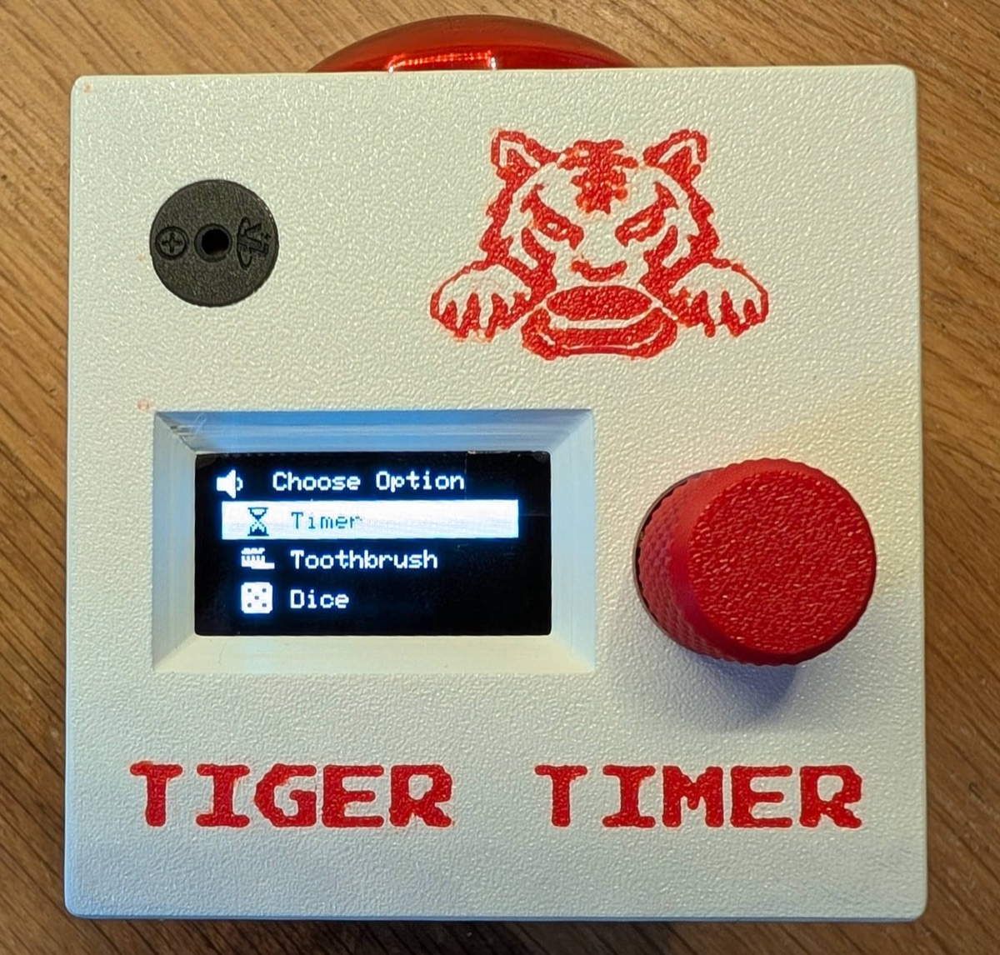
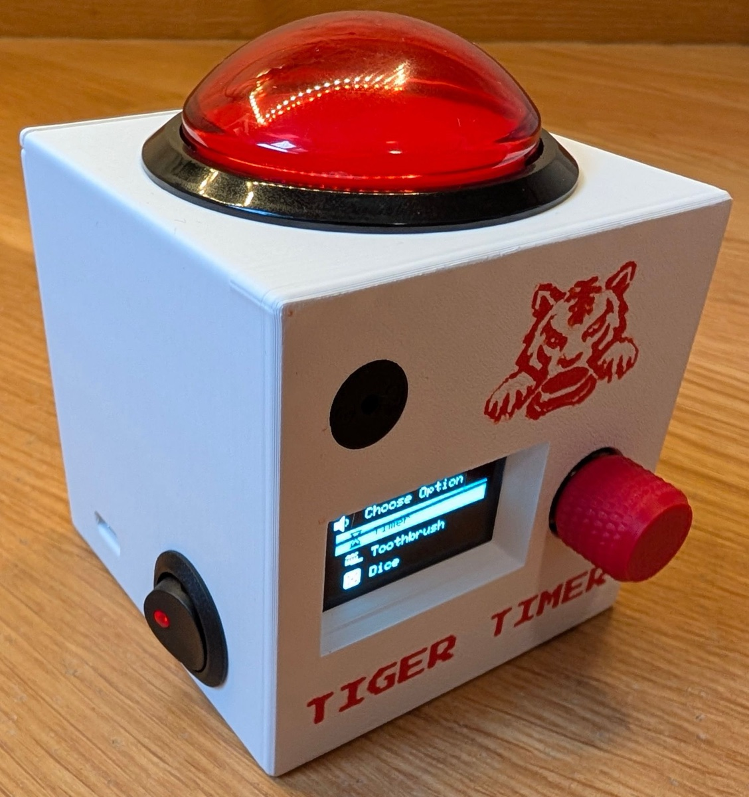
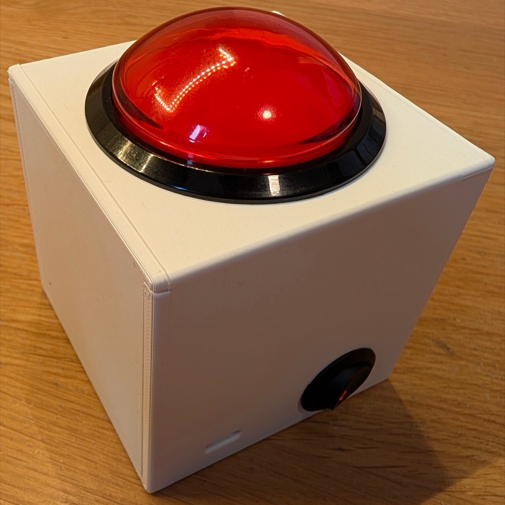
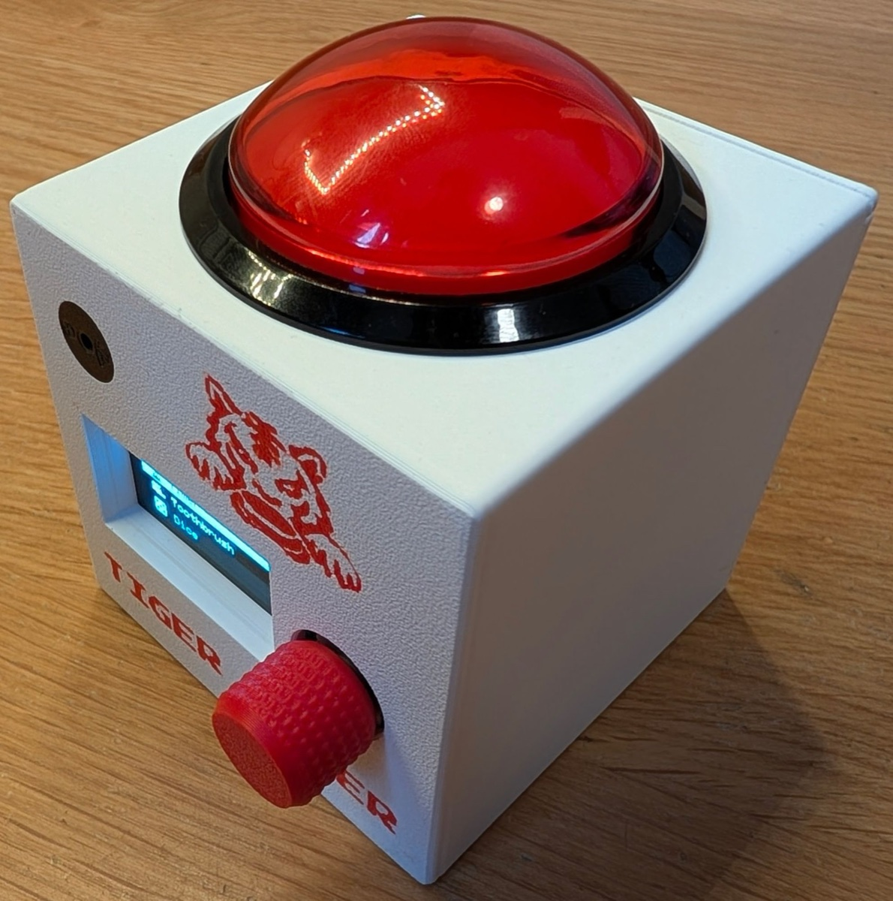
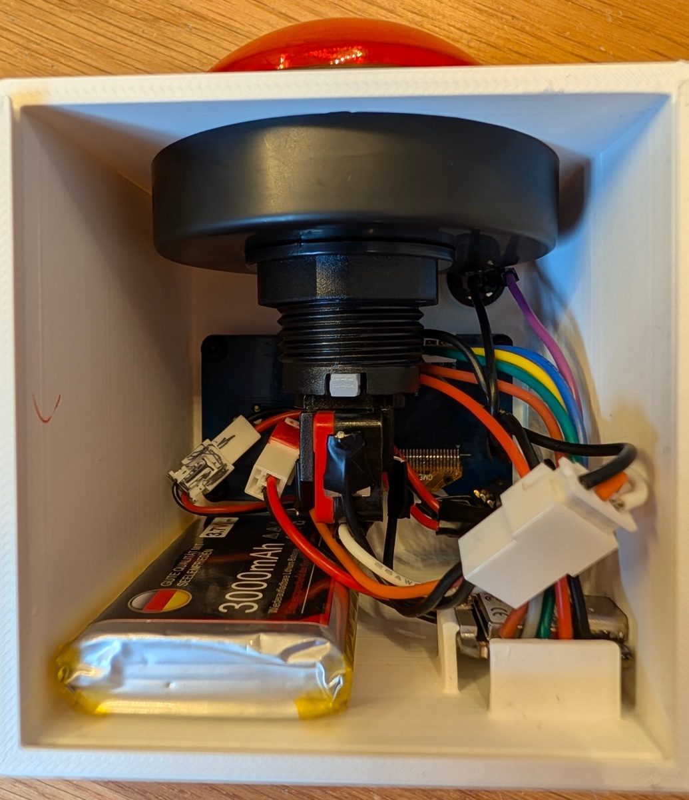
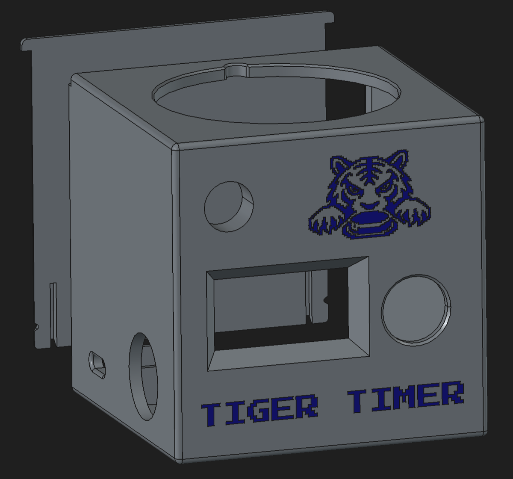

# Tiger Timer

A battery-powered, pocket-sized party-game console built on a Seeed XIAO ESP32-C6, with a 1.3"
OLED screen, a rotary knob, one big arcade button and a buzzer. It boots into a menu of 13
mini-games, in English, French or Spanish.

<p>
  
  
</p>

## Photos

| | | |
|---|---|---|
|  |  |  |
| Arcade button and power switch | Knob side | Inside: 3000 mAh battery, XIAO, wiring |
|  | | |
| 3D model of the enclosure | | |

## Games

- **Timer:** a countdown from 10 seconds to 90 minutes. The button light blinks faster as time runs out.
- **Toothbrush Timer:** 1 to 5 minutes split into 6 zones (upper and lower, left, front, right),
  with a beep at each zone change.
- **Dice:** roll 1 to 5 dice of any common tabletop type (d4 to d20).
- **Reflex:** wait for the light, then hit the button as fast as you can. Too early and it explodes.
- **Chess Clock:** two-player countdown with a per-move increment.
- **Pass the Bomb:** a category and a letter ("Country starting with B"); answer and pass the box
  before the hidden timer goes off. 20 categories, each can be turned off.
- **Stopwatch:** a simple count-up stopwatch.
- **Quiz:** buzz in with the arcade button and pick an answer. 8 categories, 3 levels, questions
  in all three languages and editable from Remote Config.
- **Tetris:** played with the box turned on its side.
- **Star Drop:** move a telescope between 4 lanes to catch falling stars, planets and moons;
  also played on its side.
- **Snake:** the classic, steered by turning the knob left or right.
- **Pong:** one player against the computer, the knob moves the paddle.
- **SimpleMorse:** a memory game: repeat a growing Morse code word with short and long presses.

Quiz, Tetris, Star Drop, Snake, Pong and SimpleMorse start hidden on a new box and can be turned
on from Remote Config. Tetris, Star Drop, Snake and Pong keep a high score.

## Controls

- **Arcade button:** confirm / main action.
- **Knob turn:** move or adjust; **click:** confirm, or pause in some games.
- **Hold the knob and turn:** volume, from anywhere.
- **Hold the knob 1 s:** "Go back to menu?" from inside a game.

## Remote Config

Settings > Remote Config makes the box its own WiFi network (`TigerTimer-Config`) with a QR code
on screen. Join it from a phone or laptop to reorder and hide games, edit trivia questions,
choose Pass the Bomb categories, set startup behavior and the default timer, reset high scores,
and update the firmware.

## Updating a box

1. Download `TigerTimer-vX.Y.Z.bin` from [Releases](../../releases) **before** joining the box's
   WiFi (it has no internet).
2. On the box, open Remote Config and join `TigerTimer-Config`.
3. In **Firmware update**, choose the file and tap **Install update**.
4. Press the arcade button on the box to confirm. It installs, restarts and returns to the menu.

Trivia questions and settings are kept. If the file picker doesn't work in the "Sign in to
network" pop-up, open `http://192.168.4.1` in Chrome or Safari instead.

## Repository

| Path | What |
|---|---|
| `Code/tiger_timer/` | Arduino sketch (`tiger_timer.ino`, `web_config.ino`, vendored QR encoder and font) |
| `Code/tiger_timer/data/` | Trivia question CSVs, uploaded to the box's LittleFS |
| `Code/web/config.html` | Remote Config page, embedded into the firmware as `config_html.h` |
| `Code/tools/` | `embed_config_html.py` (run after editing the page), `release.sh` (build and publish a release) |
| `Code/FSD/` | Functional specification, layout reference, wiring diagram and build plan |
| `3D/` | Enclosure: FreeCAD source (`.FCStd`), `.step` export, and a print-ready `.3mf` |
| `photos/` | Photos of the finished box and a render of the enclosure model |

## Construction

**Parts**

- Seeed Studio XIAO ESP32-C6
- 1.3" SH1106 128x64 I2C OLED + EC11 rotary encoder module (one board, 9-pin header)
- Illuminated arcade button with a built-in 5 V LED
- Passive piezo buzzer (not an active one)
- 3.7 V LiPo cell with its own protection circuit (the one pictured is 3000 mAh)
- Panel-mount power switch
- JST XH connectors (2.5 mm), so every part unplugs without desoldering

**Wiring:** see the [wiring diagram](Code/FSD/assets/wiring_diagram.svg) and the pin and connector
tables in [section 2.7 of the FSD](Code/FSD/TigerTimer_FSD.md#27-wiring-diagram). No extra resistors
are needed. The battery goes to the XIAO's `BAT +` / `BAT -` pads on its underside, through the
power switch; check the polarity before soldering.

**Enclosure:** modelled in FreeCAD. Open `3D/Game Timer v1.9.1.FCStd` to edit it, use the `.step`
in other CAD tools, or send the `.3mf` straight to a slicer.

**Firmware:** build and flash as described under [Building](#building), then upload the trivia CSVs in
`Code/tiger_timer/data/` to the board's LittleFS.

## Building

- Arduino core for ESP32 3.x, board **XIAO_ESP32C6**, default partition scheme.
- Libraries: Adafruit SH110X (with Adafruit GFX and BusIO), ArduinoJson 7.x.

```bash
arduino-cli compile -b esp32:esp32:XIAO_ESP32C6:CDCOnBoot=cdc Code/tiger_timer
```

To publish a release, bump `FW_VERSION` in `tiger_timer.ino`, commit and push, then run
`Code/tools/release.sh "what changed"`.

The full behavior and hardware spec is in [Code/FSD/TigerTimer_FSD.md](Code/FSD/TigerTimer_FSD.md).
