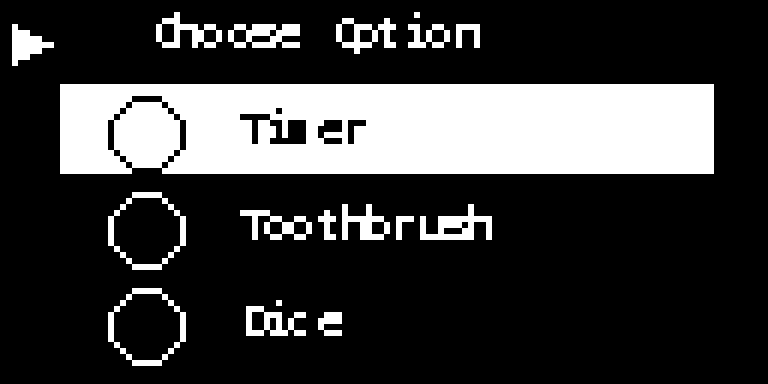

# Tiger Timer

A battery-powered, pocket-sized party-game console built on a Seeed XIAO ESP32-C6, with a 1.3"
OLED screen, a rotary knob, one big arcade button and a buzzer. It boots into a menu of 13
mini-games, in English, French or Spanish.



## Games

Timer, Reflex, Dice, Chess Clock, Pass the Bomb, Stopwatch, Toothbrush Timer, Quiz (trivia),
Tetris, Star Drop, Snake, Pong and SimpleMorse. Quiz, Tetris, Star Drop, Snake, Pong and
SimpleMorse start hidden on a new box and can be turned on from Remote Config.

## Controls

- **Arcade button:** confirm / main action.
- **Knob turn:** move or adjust; **click:** confirm, or pause in some games.
- **Hold the knob and turn:** volume, from anywhere.
- **Hold the knob 1 s:** "Go back to menu?" from inside a game.

## Remote Config

Settings > Remote Config makes the box its own WiFi network (`TigerTimer-Config`) with a QR code
on screen. Join it from a phone or laptop to reorder and hide games, edit trivia questions,
choose Pass the Bomb categories, set startup behavior and the default timer, reset high scores,
and update the firmware.

## Updating a box

1. Download `TigerTimer-vX.Y.Z.bin` from [Releases](../../releases) **before** joining the box's
   WiFi (it has no internet).
2. On the box, open Remote Config and join `TigerTimer-Config`.
3. In **Firmware update**, choose the file and tap **Install update**.
4. Press the arcade button on the box to confirm. It installs, restarts and returns to the menu.

Trivia questions and settings are kept. If the file picker doesn't work in the "Sign in to
network" pop-up, open `http://192.168.4.1` in Chrome or Safari instead.

## Repository

| Path | What |
|---|---|
| `tiger_timer/` | Arduino sketch (`tiger_timer.ino`, `web_config.ino`, vendored QR encoder and font) |
| `tiger_timer/data/` | Trivia question CSVs, uploaded to the box's LittleFS |
| `web/config.html` | Remote Config page, embedded into the firmware as `config_html.h` |
| `tools/` | `embed_config_html.py` (run after editing the page), `release.sh` (build and publish a release) |
| `FSD/` | Functional specification, layout reference, wiring diagram and build plan |

## Building

- Arduino core for ESP32 3.x, board **XIAO_ESP32C6**, default partition scheme.
- Libraries: Adafruit SH110X (with Adafruit GFX and BusIO), ArduinoJson 7.x.

```bash
arduino-cli compile -b esp32:esp32:XIAO_ESP32C6:CDCOnBoot=cdc tiger_timer
```

To publish a release, bump `FW_VERSION` in `tiger_timer.ino`, commit and push, then run
`tools/release.sh "what changed"`.

The full behavior and hardware spec is in [FSD/TigerTimer_FSD.md](FSD/TigerTimer_FSD.md).
